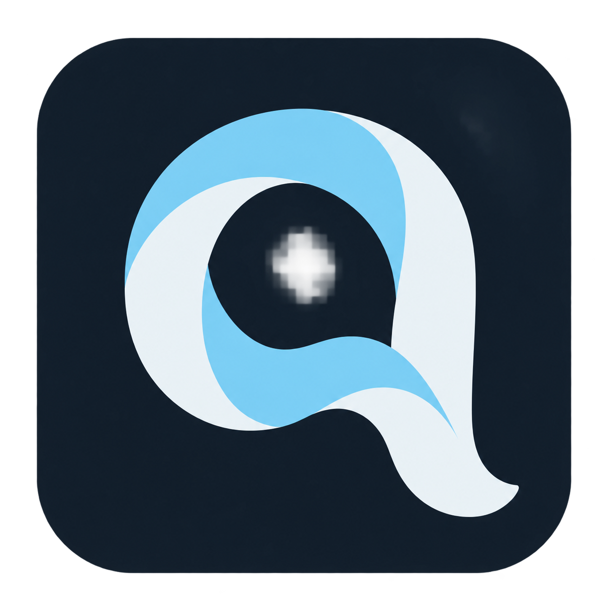
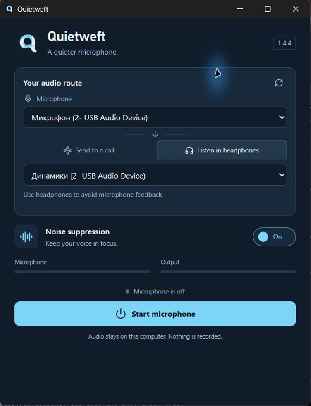
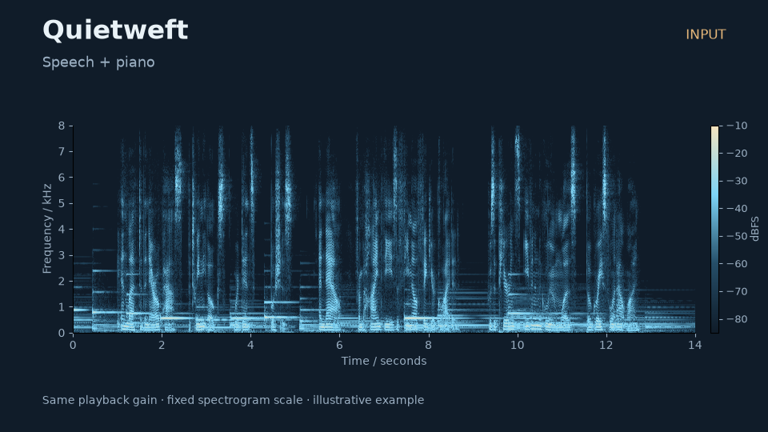
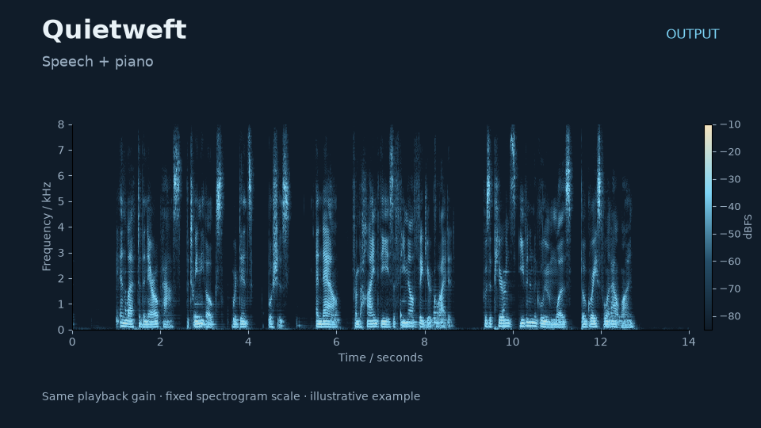

<p align="center"></p>
<h1 align="center">Quietweft</h1>
<p align="center">Local microphone noise removal. A small desktop app, a CLI, and a Rust / C runtime.</p>
<p align="center"><a href="https://github.com/drhspfn/quietweft/releases/tag/v1.4.4">Download 1.4.4</a> · <a href="docs/USAGE.md">User guide</a> · <a href="docs/TRAINING.md">Training</a> · <a href="docs/EMBEDDING.md">Embed it</a></p>

Quietweft processes microphone audio on your computer using the pretrained [GTCRN DNS3](https://github.com/Xiaobin-Rong/gtcrn) model. Choose a microphone, choose where the audio goes, and switch noise removal on or off. There are no accounts, recording uploads or automatic model downloads.

Version **1.4.4** is the first public release after private development. It preserves the working model rather than presenting an experimental fine-tune as an improvement. This release makes no comparative audio-quality claim.

<p align="center"></p>

## Download and use

| Package | What's inside |
| --- | --- |
| [Windows desktop](https://github.com/drhspfn/quietweft/releases/download/v1.4.4/quietweft-1.4.4-windows-x64-desktop.zip) | Windowed application, pinned model, required native redistributables |
| [Windows CLI + SDK](https://github.com/drhspfn/quietweft/releases/download/v1.4.4/quietweft-1.4.4-windows-x64-cli.zip) | CLI, model, shared runtime, C header and example |
| [Model only](https://github.com/drhspfn/quietweft/releases/download/v1.4.4/quietweft-1.4.4-model-gtcrn-dns3-v1.zip) | ONNX, manifest, provenance and model license |

Extract the complete desktop ZIP and open **Quietweft.exe**. Select **Listen in headphones** to test without any virtual cable. Sending processed audio into another application's microphone requires a separately installed virtual audio endpoint, or integration using the runtime. [Setup and routing →](docs/USAGE.md)

Windows builds require WebView2. Packages are unsigned. Linux and macOS have native build workflows; see the [build guide](docs/BUILDING.md) and CI status for actual validation on each platform.

## Command line

```powershell
./quietweft.exe inspect
./quietweft.exe devices
./quietweft.exe process input.wav --output cleaned.wav
./quietweft.exe benchmark input.wav
```

WAV processing needs no virtual cable or Python. Input is mono 16 kHz WAV. Live headphone monitoring and binary `pipe` mode are also available. [CLI reference →](docs/CLI.md)

## Model and latency

The bundled ONNX is fixed as `gtcrn-dns3-v1` in [the model registry](models/manifest.json). Its SHA256 is verified when loaded. The desktop app, CLI and model archive contain the same bytes. [Provenance and model contract →](docs/MODELS.md)

The runtime uses 16 kHz mono audio, 256-sample model hops and 128-sample transport blocks. Its **algorithmic delay is 24 ms**. This excludes capture/playback buffers, resampling and virtual audio routing; it is not a measured microphone-to-headphones round trip. [Timing methodology and measurements →](docs/MEASUREMENTS.md)

## Listen to examples

Input and output examples use the same gain and spectrogram scale. They illustrate behavior and are not a quality benchmark. [Audio/video comparisons, sources and reproduction →](docs/EXAMPLES.md)

| Speech + piano: input | Output |
| --- | --- |
| [](docs/media/speech-music-input.mp4) | [](docs/media/speech-music-output.mp4) |

## Train a candidate

Install [uv](https://docs.astral.sh/uv/), then from a checkout:

```sh
uv sync
uv run quietweft-train prepare --speech data/speech --noise data/noise --output data/pairs --scenes 4000
uv run quietweft-train fit --pairs data/pairs --output runs/first --epochs 100 --batch 12 --device auto --patience 12 --lr 0.00001
uv run quietweft-train export --checkpoint runs/first/best.pt --output models/candidates/first
```

Bring your own licensed speech and noise recordings. Preparation requires independent source groups for train, validation and test; it does not silently download a large corpus. Export requires an actually trained checkpoint and checks streaming ONNX parity. Candidates do not replace the released model automatically. [Training guide →](docs/TRAINING.md) · [Dataset layout →](docs/DATASETS.md)

## Build and integrate

```sh
python scripts/build.py --platform windows --target all
```

Run on the selected operating system with its native toolchain. Replace `windows` with `linux` or `macos` on that host. Packages and ZIP archives are written to `dist/`. [Prerequisites and builds →](docs/BUILDING.md)

The same processing implementation powers the desktop and CLI. Use the Rust crate or the C ABI for integration. [Rust / C embedding →](docs/EMBEDDING.md)

## License and acknowledgments

Quietweft code and brand assets are [MIT](LICENSE). GTCRN source and pretrained weights retain Rong Xiaobin's MIT license. Dependencies and example media retain their own licenses; see [third-party notices](THIRD_PARTY_NOTICES.md). Dataset licenses remain your responsibility when training. Quietweft is an independent project and is not endorsed by GTCRN's authors or Microsoft.
