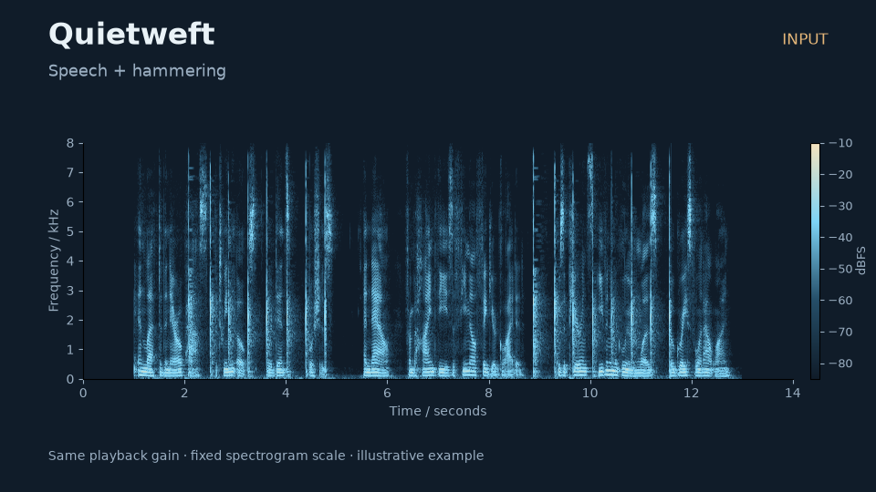
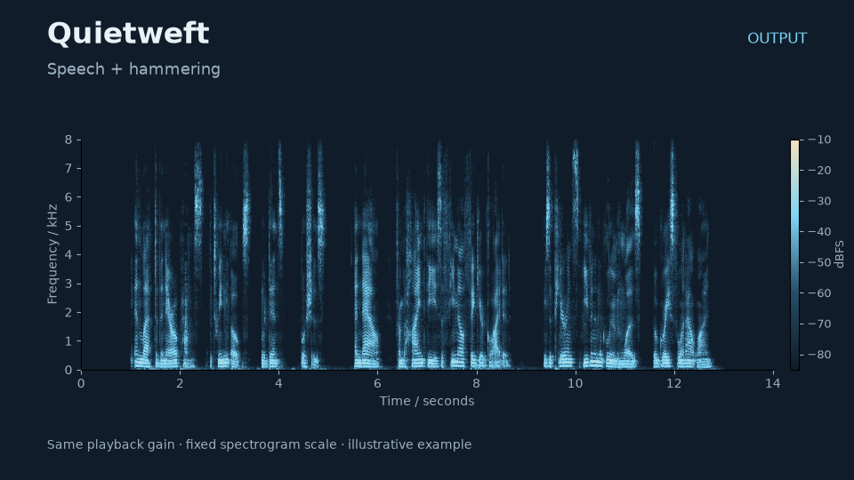

# Paired examples

Play one clip at a time. Both columns contain actual audio and a spectrogram;
the moving cursor follows playback. The output is produced by the released
`gtcrn-dns3-v1` model through the public Rust CLI at full suppression.

| Input | Output |
| --- | --- |
| [](media/speech-music-input.mp4) | [](media/speech-music-output.mp4) |
| [](media/speech-impacts-input.mp4) | [](media/speech-impacts-output.mp4) |

GitHub may open MP4 files as downloads or in a separate viewer. The linked files
are ordinary H.264/AAC videos; download them if inline playback is unavailable.

These are two illustrative mixtures, **not a benchmark or a sound-quality
claim**. They do not establish speech preservation, robustness or generalization.
The speech source is part of LibriSpeech's `train-clean-360` corpus; these clips
are not described as a held-out quality evaluation. No private user microphone
recordings are included.

Each scene is 14 seconds at 16 kHz mono. A twelve-second speech excerpt begins
at scene time 1 second. Speech RMS is set to −22 dBFS, piano/hammering to −24
dBFS before mixing. A single peak-safe gain is applied to each mixture if
needed. The CLI output is **never normalized independently**. Spectrograms all
use a fixed −85 to −10 dBFS amplitude scale, 512-sample Hann windows and
128-sample hops. Videos use ordinary AAC encoding without loudness filtering.

Source excerpts, mixing gains, original hashes, model hash and CLI hash are
recorded in [provenance.json](media/provenance.json). Attribution and the media's
separate licenses are in [media/LICENSE.md](media/LICENSE.md).

## Reproduce

Obtain the original recordings yourself under their stated licenses. Nothing is
downloaded automatically. Install FFmpeg on PATH and the optional media tools:

```sh
uv sync --extra media
python scripts/render_examples.py --help
```

Example after building the CLI (substitute your local source paths):

```sh
uv run python scripts/render_examples.py --speech sources/4236-8927-0054.flac --music sources/music-hd-0039.wav --impacts sources/noise-sound-bible-0035.wav --cli dist/quietweft-1.4.4-windows-x64-cli/quietweft.exe --model models/gtcrn-dns3-v1 --output docs/media
```

On Linux/macOS pass the corresponding built `quietweft` executable. The script
records source hashes and invokes the public CLI; it does not load a private
training checkpoint. FFmpeg or library versions can change encoded file bytes
without changing the source recordings or procedure.
